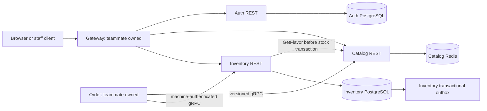

# Auth, Catalog and Inventory NFR handoff

This is the owned-service implementation/evidence section for the group's progress proposal, ADRs, diagrams and demo. It does not certify full Order/Payment checkout or deployment readiness of teammate services.

## Current request and data paths



Shared Compose discovers services through Docker DNS names `auth-service`, `catalog-service` and `batch-inventory-service`. The isolated verification uses `auth`, `catalog` and `inventory` aliases on its own private network. Gateway holds no domain data; Order never reads Inventory's private tables. User JWT verification and the Order machine credential remain separate controls.

## Reusable isolated verification

From the repository root, with Docker running, Go 1.25+, Python 3, OpenSSL and grpcurl installed:

```sh
python3 batch-inventory-service/scripts/verify-owned-nfr.py \
  --report /tmp/owned-nfr-result.json \
  --diagnostics-dir /tmp/owned-nfr-diagnostics
```

The first run needs access to the declared Go modules/container images, or a populated cache. `--mode plain` or `--mode tls` selects one profile; the default runs both. Diagnostics redact fixture secrets and never copy certificate private keys. The report contains only check results and explicit limits.

The command builds the three owned service images and the unchanged Gateway image, then compiles a disposable probe importing the actual unchanged Order clients. It creates fresh PostgreSQL/Redis containers and a private Docker network, with application ports published only on loopback. Existing databases, containers, `.env` files and the host trust store are not used. Synthetic schemas, certificates, images, application containers and the private network are cleaned on exit.

The checks observe:

1. Inventory startup rejects an unmigrated schema; the updated migrator is repeatable and readiness succeeds afterwards.
2. Actual Gateway Docker DNS/forwarding, Auth-issued Manager/Staff/Customer roles and shared-Gateway credential lockout isolation.
3. Catalog/Inventory optional REST keys survive retries through Gateway without duplicate production, history or waste events.
4. Actual default Order clients read Catalog, reserve/confirm Inventory and replay the original reservation result after confirmation. Invalid machine credentials fail.
5. Owned HTTPS/gRPC and Inventory-to-Catalog TLS verify a strict private CA/hostname chain. Gateway's unchanged HTTPS upstream client trusts the fixture CA only within its container; a different CA is rejected.
6. The existing plaintext Order clients fail against TLS listeners, explicitly demonstrating why their TLS adoption must precede activation in a shared environment. A verified TLS machine caller still completes the stock lifecycle.
7. Stock balances and actor/history facts are inspected in the fixture's own Inventory database; covered owned-service diagnostics are checked for fixture credentials and PII.

Full service suites additionally use real PostgreSQL/Redis/RabbitMQ to cover concurrency, rollback, durable outbox/recovery, legacy migration and process restart. The smoke does not publish to a shared broker or contact Stripe/Notification.

## Shared-environment rollout order

1. Choose a deployment window with the owners of active callers. Stop old Catalog/Inventory writers during cutover when complete replay/actor guarantees are required; DDL/restart can briefly interrupt Inventory.
2. Run the updated Inventory migrator before its new binary. Migration 005 adds nullable actor fields/constraints and preserves stock/IDs/timestamps; unknown historical actors stay NULL. Current Compose already invokes `/app/migrate && exec /app/inventory`. No additional migration is needed for optional REST keys.
3. Start the new binaries with existing transport defaults. Check Auth/Catalog `/health` and Inventory `/ready`, then verify an authorized batch/waste and corresponding actor records against synthetic/demo data agreed by the team.
4. Prepare server PEM pairs with service-hostname SANs, expiration/renewal and file permissions appropriate for each non-root image. Configure verified CA trust for every caller before enabling TLS. Keep private keys out of Git.
5. Gateway owner sets HTTPS upstream URLs and process CA trust. Order owner must add a TLS transport option: its current Catalog/Inventory clients call `insecure.NewCredentials()` and cannot adopt TLS through existing address settings alone. Enable inbound gRPC TLS only after that path is ready. Inventory's outbound Catalog TLS is already configurable with `CATALOG_GRPC_TLS_*`.
6. Deployment owners verify PostgreSQL/Redis/RabbitMQ TLS and private network exposure separately. This local application-transport receipt is not evidence about the production environment.

## Demo/storyboard for the group's sub-five-minute clip

- 0:00-0:40: show Docker DNS/service names and the Gateway -> service / Order -> Inventory request paths.
- 0:40-1:30: show JWT roles, separate machine authentication and verified TLS configuration.
- 1:30-2:30: replay a Catalog mutation and CreateBatch/Waste request; show one resulting mutation/audit and a 409 for changed input.
- 2:30-3:30: show Inventory's stock invariant, actor records, transaction rollback and migration readiness guard.
- 3:30-4:30: show redacted diagnostics and Auth audit cancellation/transient-error tests; state the remaining shared deployment and outage limits.

Use the real test receipt and synthetic data in the recording. The storyboard is preparation material; it is not a recorded/submitted video.

## Ownership and remaining acceptance

Our code owns Auth/Catalog/Inventory data, audits, local transport capabilities and these reproducible checks. Team integration still owns Order p95 under agreed load, confirmed-order survival during Notification outage, consumer deduplication/DLQ, external Gateway HTTPS and production network policy. Auth token-response replay and continuous-database-outage audit durability require explicit contract/availability decisions. These are not claimed as completed by an isolated service test.
