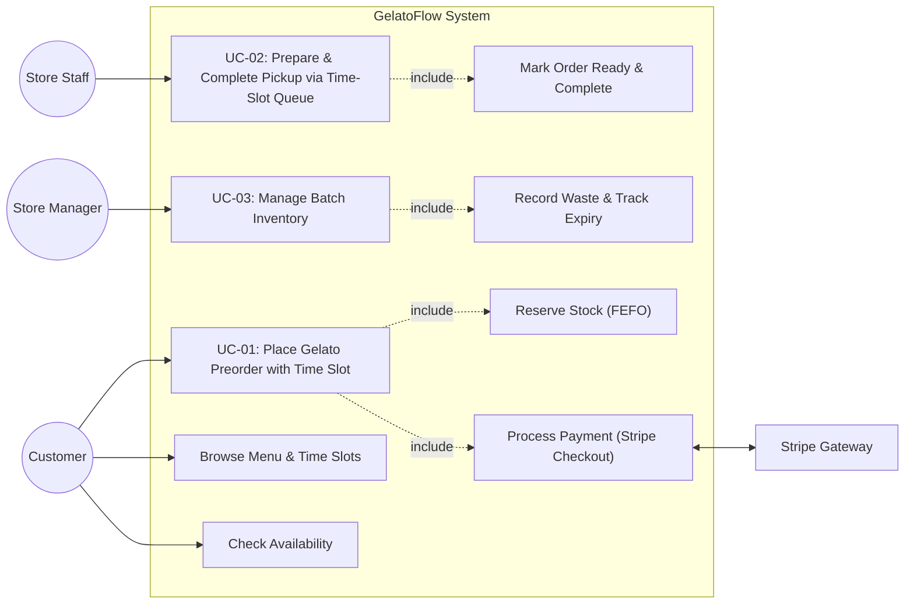
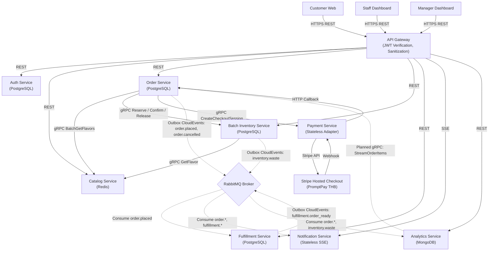

# GelatoFlow — Project Description and ADRs


**Gelato Preorder, Pickup, and Batch Inventory Management System**

*ระบบสั่งเจลาโตล่วงหน้า รับสินค้าที่ร้าน และบริหารสินค้าคงเหลือแบบราย Batch*


---


## สารบัญ (Table of Contents)


1. [Project Name](#1-project-name)

2. [Group Members](#2-group-members)

3. [Problem Description](#3-problem-description)

   - 3.1 [Project Objectives](#31-project-objectives)

   - 3.2 [Project Scope](#32-project-scope)

4. [Target Customers & Actors](#4-target-customers--actors)

   - 4.1 [Primary Customers](#41-primary-customers)

   - 4.2 [Operational Users](#42-operational-users)

   - 4.3 [External Systems](#43-external-systems)

5. [Scenarios and Business Use Cases](#5-scenarios-and-business-use-cases)

   - [UC-01 — Place Gelato Preorder with Time Slot](#uc-01--place-gelato-preorder-with-time-slot)

   - [UC-02 — Prepare and Complete Store Pickup via Time-Slot Queue](#uc-02--prepare-and-complete-store-pickup-via-time-slot-queue)

   - [UC-03 — Manage Batch Inventory](#uc-03--manage-batch-inventory)

6. [Use Case Diagram](#6-use-case-diagram)

7. [Functional Requirements (FR-01 ถึง FR-17)](#7-functional-requirements)

8. [Non-functional Requirements (NFR-01 ถึง NFR-13)](#8-non-functional-requirements)

9. [Architecture Decision Records (ADRs)](#9-architecture-decision-records-adrs)

   - [ADR-001 — Decompose the System by Business Capability](#adr-001--decompose-the-system-by-business-capability)

   - [ADR-002 — Make Batch Inventory the Single Source of Truth for Stock](#adr-002--make-batch-inventory-the-single-source-of-truth-for-stock)

   - [ADR-003 — Use Synchronous gRPC for Order-to-Inventory Reservation](#adr-003--use-synchronous-grpc-for-order-to-inventory-reservation)

   - [ADR-004 — Use RabbitMQ for Non-blocking Domain Events](#adr-004--use-rabbitmq-for-non-blocking-domain-events)

   - [ADR-005 — Expose Client APIs through REST and an API Gateway](#adr-005--expose-client-apis-through-rest-and-an-api-gateway)

   - [ADR-006 — Expose Catalog through REST and gRPC using Shared Application Logic](#adr-006--expose-catalog-through-rest-and-grpc-using-shared-application-logic)

   - [ADR-007 — Implement Inventory Transactions and Explicit Caller Boundaries](#adr-007--implement-inventory-transactions-and-explicit-caller-boundaries)

   - [ADR-008 — Separate Identity Ownership and Service-Owned Authorization](#adr-008--separate-identity-ownership-and-service-owned-authorization)

   - [ADR-009 — Let Order Orchestrate PromptPay Checkout and Durable Recovery](#adr-009--let-order-orchestrate-promptpay-checkout-and-durable-recovery)

10. [Term Project Deliverable #2: Microservice Design with Collaborations](#10-term-project-deliverable-2-microservice-design-with-collaborations-revised-tab)

    - 10.1 [Actors and 3 Core Business Use Cases](#101-actors-and-3-core-business-use-cases)

    - 10.2 [Full Service–Operations–Collaborators Table](#102-full-serviceoperationscollaborators-table)

    - 10.3 [System Architecture & Invocation Flows](#103-system-architecture--invocation-flows)

    - 10.4 [End-to-End Use Case Traceability Walkthrough](#104-end-to-end-use-case-traceability-walkthrough)


---


## 1. Project Name


**GelatoFlow — Gelato Preorder, Pickup, and Batch Inventory Management System**

ระบบสั่งเจลาโตล่วงหน้า รับสินค้าที่ร้าน และบริหารสินค้าคงเหลือแบบราย Batch


---


## 2. Group Members


| No. | Student ID / รหัสนิสิต | Name–Surname / ชื่อ–นามสกุล |

|:---:|:---------------------:|:---------------------------|

| 1 | 6631337421 | Pornmongkol Tonnikorn |

| 2 | 6630016821 | Kritsada Chan-Inn |

| 3 | 6632088321 | Tinnapat Sittisuwan |

| 4 | 6632154021 | Peeradon Thienpongkasem |

| 5 | 6630199021 | Phaolap Kulteera |


---


## 3. Problem Description


ร้านเจลาโตมีข้อจำกัดด้านสินค้าคงเหลือที่แตกต่างจากสินค้าทั่วไป เพราะสินค้าแต่ละรสผลิตเป็น Batch มีจำนวน portion จำกัด มีวันหมดอายุ และอาจเกิด waste ระหว่างวัน ในช่วงที่มีลูกค้าจำนวนมาก ลูกค้าไม่ทราบล่วงหน้าว่ารสชาติที่ต้องการยังมีอยู่หรือไม่ ต้องรอคิวที่หน้าร้าน และอาจเดินทางมาแล้วพบว่าสินค้าหมด ขณะที่พนักงานต้องประสานคำสั่งซื้อ การชำระเงิน คิวเตรียมสินค้า และจำนวนคงเหลือด้วยหลายขั้นตอน


ปัญหาที่มีผลกระทบสูงที่สุดคือ **Overselling** หากลูกค้าหลายคนสั่ง portion สุดท้ายพร้อมกัน ระบบที่ตรวจสอบและตัด stock แยกขั้นตอนกันอาจยืนยันหลาย order เกินจำนวนจริง ทำให้เกิด negative stock การยกเลิกคำสั่งซื้อ หรือประสบการณ์ที่ไม่ดีต่อลูกค้า


นอกจากนี้ ในระบบการสั่งและรับสินค้าหน้าร้านแบบดั้งเดิม การที่ลูกค้าเดินทางมาถึงโดยไม่มีการนัดหมายช่วงเวลาล่วงหน้า มักก่อให้เกิดปัญหาคิวแออัดหน้าร้านแบบกะทันหัน (**Arrival Spikes**) พนักงานในครัวจัดลำดับการเตรียมสินค้าได้ยาก และเจลาโตเป็นของหวานที่ละลายเร็วและไวต่ออุณหภูมิ จึงไม่สามารถตักเตรียมทิ้งไว้ล่วงหน้านานเกินไปได้


GelatoFlow แก้ปัญหานี้ด้วยสถาปัตยกรรมแบบ **Event-Driven Microservices** และระบบบริหารจัดการคิวตามช่วงเวลารับสินค้า (**Time-Slot Queue Management System**) โดยลูกค้าสามารถตรวจสอบความพร้อมของสินค้าและเลือกช่วงเวลารับสินค้าที่ต้องการ (เช่น 14:00 - 14:15 น.) เมื่อชำระเงินสำเร็จ ระบบจะจัดสรรหมายเลขคิวเฉพาะเจาะจงภายใน Time Slot นั้น ๆ (เช่น Slot 14:00 - 14:15 -> Queue #01, #02) ทำให้การกระจายตัวของคิวเป็นระเบียบ หน้าร้านไม่แออัด และพนักงานสามารถตักเจลาโตตามลำดับคิวในแต่ละรอบเวลาได้อย่างสดใหม่ โดยมี **Batch Inventory Service** เป็นผู้ตัดสินใจเรื่อง stock เพียงจุดเดียว


### Primary Business Flow / กระบวนการหลัก


```text

Browse Gelato & Time Slots

  -> Check Availability

  -> Select Slot & Place Order

  -> Reserve Stock (Atomic FEFO)

  -> Pay (Stripe Checkout Session / PromptPay)

  -> Slot Queue Allocation

  -> Prepare by Slot

  -> Ready Notification (SSE)

  -> Complete Pickup in Slot

```


### 3.1 Project Objectives

- ลดเวลารอและความแออัดหน้าร้านด้วยระบบเลือกช่วงเวลารับ (Time Slot) และจัดคิวประจำ Slot

- ป้องกัน overselling และ negative stock ภายใต้ concurrent requests ด้วย Batch Inventory Service

- ช่วยให้พนักงานเห็น preparation queue จัดกลุ่มตาม Time Slot และลำดับคิวอย่างเป็นระบบ

- บริหารการผลิต การจอง การขาย waste และวันหมดอายุในระดับ batch

- บันทึกข้อมูลที่ตรวจสอบย้อนหลังได้เพื่อวางแผนผลิตและลด waste


### 3.2 Project Scope


| In scope / อยู่ในขอบเขต | Out of scope / นอกขอบเขต |

|---|---|

| 1–2 สาขา, 8–12 flavors | Delivery and route planning |

| Web preorder and store pickup | IoT freezer/sensor integration |

| Pickup time-slot selection and slot-scoped queue management | Complex loyalty tiers |

| Stripe Checkout Session integration (PromptPay / Card in THB) | Multi-country tax and settlement |

| Batch inventory, atomic reservation (FEFO), waste, expiration | Enterprise-scale analytics platform |


---


## 4. Target Customers & Actors


### 4.1 Primary Customers

- **Customer / ลูกค้าร้านเจลาโต:** ผู้ที่ต้องการสั่งและเลือกรอบเวลารับสินค้าล่วงหน้า ลดเวลารอหน้าร้าน และมั่นใจว่าสินค้าถูกจองไว้แล้ว ใช้งานผ่านเว็บเพื่อตรวจสอบสต็อก เลือกรอบเวลารับ (Pickup Time Slot) ชำระเงินผ่านระบบออนไลน์ (Stripe PromptPay/Card) และรับหมายเลขคิวประจำ Slot


### 4.2 Operational Users

- **Store Staff / พนักงานร้าน:** รับคำสั่งซื้อจาก preparation queue ที่จัดกลุ่มตาม Time Slot และหมายเลขคิว ตักเตรียมเจลาโตตามรอบเวลา และยืนยันการส่งมอบด้วยหมายเลขคิวประจำ Slot

- **Store Manager / ผู้จัดการร้าน:** จัดการ flavor, recipe, allergen และ pickup time slots; บันทึก batch ใหม่พร้อม `batch_code`; บันทึก waste; ตรวจ low stock และ expiration


### 4.3 External Systems

- **Stripe Payment Gateway:** ผู้ให้บริการ Payment Gateway ภายนอก รับคำขอสร้าง Checkout Session และส่งผลการชำระเงินผ่าน Webhook ยืนยันผลแบบ Asynchronous


---


## 5. Scenarios and Business Use Cases


### UC-01 — Place Gelato Preorder with Time Slot


| Item | Description |

|---|---|

| **Primary actor** | Customer / ลูกค้า |

| **Goal** | เลือกเจลาโตที่มีจำหน่าย จอง portion เลือกรอบเวลารับสินค้า (Pickup Time Slot) ชำระเงิน และได้รับ order confirmation พร้อมหมายเลขคิวประจำ Slot |

| **Trigger** | ลูกค้าเลือกสินค้า เลือกรอบเวลารับสินค้า และกดยืนยันการสั่งซื้อ |

| **Preconditions** | ร้านและ pickup time slot เปิดรับคำสั่งซื้อ; Catalog, Batch Inventory, Order และ Payment Service พร้อมใช้งาน |

| **Success result** | ระบบยืนยัน order, reservation, การชำระเงินสำเร็จ และจัดสรรหมายเลขคิวประจำ Slot โดยไม่มีการขายเกิน stock |


#### Main scenario / ขั้นตอนหลัก:

1. ลูกค้าตรวจสอบรายการเจลาโต ความพร้อมของสต็อกคงเหลือ และรอบเวลารับสินค้าที่เปิดรับ

2. ลูกค้าเลือกรสชาติ จำนวน และระบุรอบเวลารับสินค้าที่ต้องการ (เช่น 14:00 - 14:15 น.) พร้อมส่งคำสั่งซื้อผ่าน API Gateway

3. Order Service ตรวจสอบความถูกต้องและราคาจาก Catalog Service จากนั้นเรียก Batch Inventory Service เพื่อจองสต็อกสินค้าทันที (`ReservePortions`) ตามนโยบาย FEFO

4. Order Service บันทึกสถานะ `PENDING_PAYMENT` พร้อม reservation ID และเรียก Payment Service ผ่าน gRPC (`CreateCheckoutSession`) เพื่อสร้าง Stripe Checkout Session

5. ลูกค้าได้รับ `checkout_url` และทำการชำระเงินผ่าน Stripe Checkout (PromptPay หรือบัตรเครดิต)

6. เมื่อลูกค้าชำระเงินสำเร็จ Stripe ส่ง signed webhook มายัง Payment Service ซึ่งตรวจสอบลายเซ็นแล้วเรียก HTTP callback กลับมายัง Order Service (`payment-succeeded`)

7. Order Service ปรับสถานะเป็น `PAYMENT_CONFIRMING` และเรียก Batch Inventory Service ยืนยันการตัดสต็อกถาวร (`ConfirmReservation`)

8. เมื่อตัดสต็อกสำเร็จ Order Service บันทึกสถานะเป็น `PAID` พร้อมบันทึก domain event `order.placed` ลงใน Transactional Outbox

9. ระบบจัดสรรหมายเลขคิวต่อเนื่องเฉพาะช่วงเวลานั้น (เช่น Slot 14:00 - 14:15 น. ได้รับคิว #01) และส่งข้อมูลเข้าคิวเตรียมสินค้าของ Fulfillment Service

10. Notification Service ส่งการแจ้งเตือนยืนยันคำสั่งซื้อ รายละเอียดรอบเวลารับ และหมายเลขคิวประจำ Slot ให้ลูกค้าทราบผ่าน Server-Sent Events (SSE)


#### Alternative/exception flows / กรณีทางเลือก:

- หากสต็อกไม่เพียงพอ Batch Inventory จะปฏิเสธการจองทันที ลูกค้าจะไม่สามารถสั่งซื้อได้

- หากการชำระเงินไม่สำเร็จ หมดเวลา หรือลูกค้ายกเลิก Order Service จะปรับสถานะเป็น `CANCEL_PENDING`, เรียกปล่อยสต็อกคืน (`ReleaseReservation`), และปรับเป็น `CANCELLED`

- หากคำสั่งซื้อเดิมถูกส่งซ้ำด้วย `Idempotency-Key` เดิม ระบบจะส่งผลลัพธ์เดิมกลับไปโดยไม่สร้างคำสั่งซื้อหรือจองสต็อกซ้ำ

- หากรอบเวลารับสินค้า (Time Slot) เต็ม ระบบจะแจ้งเตือนให้ลูกค้าเลือกรอบเวลาใหม่


---


### UC-02 — Prepare and Complete Store Pickup via Time-Slot Queue


| Item | Description |

|---|---|

| **Primary actor** | Store Staff / พนักงานร้าน |

| **Supporting actor** | Customer / ลูกค้า |

| **Goal** | พนักงานในครัวเตรียม order ตามรอบเวลาและหมายเลขคิว แจ้งสถานะพร้อมรับ และส่งมอบสินค้าตามหมายเลขคิวเมื่อลูกค้ามาถึงในรอบเวลา |

| **Trigger** | Staff เปิด preparation queue dashboard หรือถึงรอบเวลาของ pickup time slot |

| **Preconditions** | Order ชำระเงินแล้ว (PAID) และระบบจัดสรรหมายเลขคิวประจำ Slot เรียบร้อยใน Fulfillment Service |

| **Success result** | ลูกค้าได้รับสินค้าตามรอบเวลา สถานะเปลี่ยนเป็น `COMPLETED` และวงจรการส่งมอบเสร็จสมบูรณ์ |


#### Main scenario / ขั้นตอนหลัก:

1. พนักงานร้านเปิดดูหน้าจอรายการเตรียมสินค้าที่จัดกลุ่มและเรียงตามรอบเวลา (Time Slot) และหมายเลขคิว

2. พนักงานเริ่มตักเตรียมเจลาโตตามลำดับคิวในรอบเวลานั้น และปรับสถานะเป็น `PREPARING`

3. เมื่อเตรียมเสร็จ พนักงานเปลี่ยนสถานะเป็น `READY_FOR_PICKUP` ซึ่งส่ง event `fulfillment.order_ready`

4. Notification Service ส่งสัญญาณ popup แจ้งเตือนลูกค้าผ่านเบราว์เซอร์ทันทีว่าสินค้าพร้อมรับแล้ว

5. ลูกค้าเดินทางมาถึงร้านในช่วงเวลาที่นัดหมาย และแสดงหมายเลขคิวประจำ Slot หรือ Order ID

6. พนักงานตรวจสอบความถูกต้อง ส่งมอบสินค้าให้ลูกค้า และบันทึกสถานะเป็น `COMPLETED` (`PICKED_UP`)


---


### UC-03 — Manage Batch Inventory


| Item | Description |

|---|---|

| **Primary actor** | Store Manager / ผู้จัดการร้าน |

| **Goal** | บันทึกการผลิต ติดตามคงเหลือ บันทึก waste และหยุดจำหน่าย batch หมดอายุ |

| **Trigger** | มีการผลิต batch ใหม่, พบ waste หรือต้องตรวจสอบ stock |

| **Preconditions** | ผู้จัดการมีสิทธิ์ผ่านการยืนยันตัวตนด้วยบทบาท `MANAGER` |

| **Success result** | ยอด stock และประวัติ batch ถูกต้อง ตรวจสอบย้อนหลังได้ และ batch หมดอายุไม่ถูกนำไปขาย |


#### Main scenario / ขั้นตอนหลัก:

1. ผู้จัดการร้านสร้าง Batch การผลิตใหม่ ระบุรสชาติ จำนวนผลิต วันผลิต วันหมดอายุ และ `batch_code`

2. ระบบตรวจสอบความถูกต้องว่ารสชาตินั้นมีอยู่จริงและ Active ใน Catalog Service จากนั้นบันทึกข้อมูล Batch

3. ผู้จัดการร้านตรวจสอบสถานะสต็อกแบบเรียลไทม์ ทั้งยอดผลิต ยอดจอง ยอดขาย ของเสีย และจำนวนคงเหลือพร้อมขาย

4. เมื่อเกิดของเสีย ผู้จัดการร้านระบุ Batch จำนวน และสาเหตุเพื่อบันทึกของเสีย (`recordWaste`)

5. ระบบคำนวณยอดคงเหลือใหม่ตาม Invariant และส่ง event `inventory.waste` เข้า Transactional Outbox

6. Batch ที่หมดอายุจะถูกตัดออกจากการจำหน่ายโดยอัตโนมัติผ่าน Periodic Expiry Worker


---


## 6. Use Case Diagram





---


## 7. Functional Requirements


| ID | Functional requirement | Related use case |

|:---:|---|:---:|

| **FR-01** | ระบบต้องแสดง flavor, price, availability (สต็อกคงเหลือ) และ pickup time slots ที่เปิดรับตามสาขา | UC-01 |

| **FR-02** | ลูกค้าต้องเลือก quantity, customization และระบุช่วงเวลารับสินค้า (Pickup Time Slot) ได้ | UC-01 |

| **FR-03** | ระบบต้องตรวจและ reserve stock ก่อนยืนยัน order ด้วยนโยบาย FEFO | UC-01 |

| **FR-04** | ระบบต้องรองรับการชำระเงินผ่าน Stripe Checkout Session (PromptPay / Credit Card) | UC-01 |

| **FR-05** | คำขอสร้าง order ซ้ำด้วย `Idempotency-Key` เดิมต้องไม่สร้าง order หรือ reservation ซ้ำ | UC-01 |

| **FR-06** | เมื่อ order ชำระเงินสำเร็จ ระบบต้องจัดสรรหมายเลขคิวต่อเนื่องเฉพาะภายใน Time Slot นั้น (Slot Queue Number) | UC-01 |

| **FR-07** | ลูกค้าต้องดู order status, รายละเอียดรอบเวลา (Time Slot) และหมายเลขคิวประจำ Slot ได้ | UC-01, UC-02 |

| **FR-08** | Staff ต้องดู preparation queue ที่จัดกลุ่มและจัดลำดับตาม Pickup Time Slot และ Slot Queue Number ได้ | UC-02 |

| **FR-09** | Staff ต้องเปลี่ยนสถานะตาม transition ที่อนุญาต (`PREPARING` -> `READY_FOR_PICKUP` -> `COMPLETED`) | UC-02 |

| **FR-10** | ระบบต้องแจ้งเตือนลูกค้าเมื่อ order ยืนยันพร้อมคิวประจำ Slot และเมื่อ order เปลี่ยนเป็น `READY_FOR_PICKUP` ผ่าน SSE | UC-01, UC-02 |

| **FR-11** | Staff ต้องตรวจหมายเลขคิวประจำ Slot และยืนยันการรับสินค้า (Complete Pickup) ได้ | UC-02 |

| **FR-12** | Manager ต้องสร้าง batch พร้อมจำนวนผลิต วันหมดอายุ และ production `batch_code` ได้ | UC-03 |

| **FR-13** | ระบบต้องแสดง produced, reserved, sold, waste และ available ต่อ batch แบบเรียลไทม์ | UC-03 |

| **FR-14** | Manager ต้องบันทึก waste พร้อม quantity และ reason ได้ | UC-03 |

| **FR-15** | ระบบต้องไม่นำ batch ที่หมดอายุไป allocate หรือ reserve ให้ order ใหม่ | UC-01, UC-03 |

| **FR-16** | ระบบต้องสร้าง low-stock และ batch-expiration alert เมื่อสต็อกใกล้หมดหรือใกล้หมดอายุ | UC-03 |

| **FR-17** | ระบบต้องเก็บ audit record สำหรับการเปลี่ยนแปลงข้อมูลสำคัญและการปรับปรุงสต็อก | UC-03 |


---


## 8. Non-functional Requirements


| ID | Quality Attribute | Requirement and Measurable Criterion |

|:---:|:---:|---|

| **NFR-01** | **Consistency** | ทุก batch ต้องรักษา Invariant: $Available = Produced - Reserved - Sold - Waste$ และ $Available \ge 0$ เสมอ ไม่มียอดติดลบ |

| **NFR-02** | **Concurrency Reliability** | เมื่อมีสินค้าคงเหลือ $Available = 1$ portion และมี 20 concurrent order requests แย่งจองพร้อมกัน ระบบต้องตัดจองสำเร็จเพียง 1 รายการ และ Available ต้องคงเหลือ 0 ไม่ติดลบ |

| **NFR-03** | **Performance** | Order Creation API ต้องมีค่า Latency **$p95 \le 1.0$ วินาที** ภายใต้โหลดทดสอบ MVP ที่กำหนด |

| **NFR-04** | **Availability & Fault Isolation** | ความล้มเหลวของ downstream services (เช่น Notification Service ล่ม) ต้องไม่ทำให้คำสั่งซื้อที่จ่ายเงินแล้ว (Confirmed Order) สูญหายหรือล้มเหลว |

| **NFR-05** | **Reliability & Messaging** | การส่งข้อมูลแบบ Asynchronous ผ่าน RabbitMQ ต้องใช้ Transactional Outbox; Consumer ทุกตัวต้องรองรับ At-least-once delivery โดยทำ Idempotent Deduplication ผ่าน CloudEvents `id` และต้องมีระบบ Dead Letter Queue (DLQ) สำหรับ Poison messages |

| **NFR-06** | **Security & Access Control** | การเชื่อมต่อต้องเข้ารหัสด้วย TLS; ใช้ Role-Based Access Control (`CUSTOMER`, `STAFF`, `MANAGER`); รหัสผ่านต้องเข้ารหัสด้วย Adaptive Hash (bcrypt); ห้ามเก็บ Plaintext Password หรือข้อมูลบัตรเครดิตในระบบเด็ดขาด |

| **NFR-07** | **Privacy & Log Redaction** | Application Log ต้อง Redact ข้อมูลสำคัญโดยอัตโนมัติ เช่น Bearer Access Tokens, Machine Secrets, Stripe Webhook Signatures และข้อมูลส่วนบุคคล (PII) ที่ไม่จำเป็น |

| **NFR-08** | **Auditability** | ทุกการปรับปรุง Batch, การบันทึก Waste, การเปลี่ยนแปลงข้อมูลสารก่อภูมิแพ้ (Allergen), และ Privileged Actions ของ Staff/Manager ต้องมี Audit Record ตรวจสอบย้อนหลังได้ |

| **NFR-09** | **Modifiability & Boundary** | Service อื่นต้องเข้าถึงข้อมูลผ่าน API/gRPC Contract ของ Service เจ้าของข้อมูลเท่านั้น ห้ามอ่าน/เขียน Private Database ของ Service อื่นโดยตรง และห้ามทำ Duplicate/Shadow Tables ข้าม Service |

| **NFR-10** | **Monetary Precision** | ข้อมูลจำนวนเงินทั้งหมดต้องเก็บและคำนวณในรูป **Integer Minor Units** (เช่น Satang ใน THB) ร่วมกับระบุ ISO 4217 Currency อย่างชัดเจน ห้ามใช้ Floating-point decimals ในการเก็บหรือส่งต่อข้อมูลเงินเด็ดขาด |

| **NFR-11** | **Idempotency Standard** | ทุก Mutation REST Endpoint ต้องรองรับ Header `Idempotency-Key` (UUID); การส่งคำขอเดิมซ้ำต้อง Replay ผลลัพธ์เดิมที่สำเร็จ; หากส่งคำขอที่มี payload ขัดแย้งกันด้วย key เดิมต้องตอบกลับ HTTP 409 Conflict |

| **NFR-12** | **Stateless Architecture** | Notification Service (SSE) และ Payment Service ต้องออกแบบเป็น Stateless Service โดยไม่ถือครอง Local Database ของตนเอง เพื่อรองรับการ Restart และ Horizontal Scaling ได้อย่างอิสระ |

| **NFR-13** | **Network & Container Isolation** | พอร์ตของฐานข้อมูลระดับ Operational (PostgreSQL, Redis, MongoDB) และ RabbitMQ Broker ต้องถูกจำกัดสิทธิ์ให้อยู่ภายใน Docker Internal Network เท่านั้นในโหมด Production ห้ามเปิด Public Port สู่ Internet ภายนอก |


---


## 9. Architecture Decision Records (ADRs)


### ADR-001 — Decompose the System by Business Capability

- **Status:** Accepted (Revised with Dedicated Auth Service)

- **Context:** GelatoFlow ประกอบด้วยขอบเขตงานทางธุรกิจที่แตกต่างกัน ได้แก่ Identity/Authentication, Catalog, Ordering, Batch Inventory, Payment, Fulfillment, Notification, และ Analytics การรวมระบบไว้ใน Monolith เดียวจะทำให้เกิด Concurrency Bottleneck, ขาดความเป็นเจ้าของข้อมูล (Data Ownership), และขยายระบบตามโหลดงานเฉพาะส่วนไม่ได้

- **Decision:** Decompose ระบบออกเป็น 8 บริการย่อยอิสระตาม Business Capability:

  1. **API Gateway:** Routing กลาง, ล้าง Spoofed Identity Headers, ตรวจสอบ JWT ด่านแรก, จัดการ CORS

  2. **Auth Service:** บริหารจัดการบัญชีผู้ใช้, จัดการสิทธิ์ RBAC, และออก Signed JWT Access Token (HS256)

  3. **Catalog Service:** ดูแลข้อมูลรสชาติเจลาโต, ราคา, สูตร, สารก่อภูมิแพ้ (เก็บใน Redis)

  4. **Order Service:** ดูแลวงจรคำสั่งซื้อ, Snapshot ราคา, เชื่อมโยง Session การจ่ายเงิน, จัดการ Outbox

  5. **Batch Inventory Service:** เป็น Single Source of Truth เพียงแห่งเดียวสำหรับล็อตการผลิต สต็อกคงเหลือ การจอง (FEFO) และของเสีย

  6. **Payment Service:** Stateless Adapter เชื่อมต่อกับ Stripe API, จัดการ Checkout Session gRPC และตรวจสอบ Webhook

  7. **Fulfillment Service:** ดูแลคิวเตรียมสินค้าในครัว จัดการคิวตาม Time Slot และการส่งมอบสินค้า

  8. **Notification Service:** Stateless Service แจ้งเตือนลูกค้าผ่าน Server-Sent Events (SSE)

  9. **Analytics Service:** รับ Asynchronous Events เพื่อคำนวณสถิติยอดขายและของเสียใน MongoDB

- **Consequences:** ความรับผิดชอบและขอบเขตข้อมูลชัดเจน แยก Deploy และขยายระบบตามส่วนงานได้ แต่ต้องการการสื่อสารข้าม Service ที่รัดกุม


---


### ADR-002 — Make Batch Inventory the Single Source of Truth for Stock

- **Status:** Accepted

- **Context:** ความเสี่ยงหลักของระบบคือ Overselling เมื่อหลายคำสั่งซื้อพยายามซื้อ portion สุดท้ายพร้อมกัน หาก Order Service หรือ Service อื่นสามารถแก้ไขหรือคำนวณสต็อกได้เอง จะไม่สามารถการันตี Invariant ได้

- **Decision:** ให้ Batch Inventory Service เป็นผู้ตัดสินใจเรื่องสต็อกแต่เพียงผู้เดียว ข้อมูลสต็อกทั้งหมดเป็น Private Database การจองใช้ Atomic PostgreSQL Transaction ร่วมกับ Advisory Lock แยกตาม Flavor และห้าม Service อื่นเข้าถึงฐานข้อมูลของ Inventory โดยตรง

- **Consequences:** บังคับ Invariant $Available = Produced - Reserved - Sold - Waste \ge 0$ ได้อย่างแม่นยำ ป้องกัน Overselling ได้ 100%


---


### ADR-003 — Use Synchronous gRPC for Order-to-Inventory Reservation

- **Status:** Accepted

- **Context:** ในระหว่างกระบวนการ Checkout ระบบต้องทราบผลการจองสต็อกทันทีแบบ Real-time ก่อนส่ง URL ชำระเงินให้ลูกค้า การสื่อสารด้วย Asynchronous จะทำให้เกิดสถานะก้ำกึ่งและต้องมีการชดเชยยกเลิกคำสั่งซื้อภายหลังมากเกินไป ขณะที่ REST ภายในมี overhead ด้าน Serialization สูง

- **Decision:** Order Service สื่อสารกับ Batch Inventory Service แบบ Synchronous ผ่าน gRPC (`contracts/proto/inventory/v1/inventory.proto`) สำหรับเมธอด `CheckAvailability`, `ReservePortions`, `ConfirmReservation`, และ `ReleaseReservation` โดยทุก Call ต้องมี Bounded Deadline และส่ง `Idempotency-Key` เสมอ

- **Consequences:** ทราบผลการจองสต็อกทันทีในระดับมิลลิวินาที สัญญา Interface ถูกบังคับอย่างเข้มงวดด้วย Protobuf


---


### ADR-004 — Use RabbitMQ for Non-blocking Domain Events

- **Status:** Accepted

- **Context:** หลังการชำระเงินเสร็จสิ้น มีกระบวนการต่อเนื่องหลายอย่าง เช่น การจัดคิวในครัว และการแจ้งเตือนลูกค้า ซึ่งไม่ควรนำมาหน่วงเวลา Response Time ของลูกค้า และไม่ควรทำให้การสั่งซื้อล้มเหลวหากระบบแจ้งเตือนมีปัญหาชั่วคราว

- **Decision:** ใช้ Asynchronous Domain Events ผ่าน RabbitMQ Broker โดย Service ต้นทาง (เช่น Order Service) บันทึก Event ลงใน Transactional Outbox ตารางเดียวกับข้อมูลทางธุรกิจ จากนั้น Outbox Dispatcher จะ Publish Event ในรูปแบบ **CloudEvents 1.0 JSON** ไปยัง Topic Exchanges ที่กำหนด พร้อมใช้ Publisher Confirms และ Mandatory Routing

- **Consequences:** ลูกค้าได้รับผลการสั่งซื้ออย่างรวดเร็ว ระบบ downstream แยกตัวเป็นอิสระ (Decoupled) และทนทานต่อความล้มเหลว (Fault-tolerant) ภายใต้โมเดล Eventual Consistency


---


### ADR-005 — Expose Client APIs through REST and an API Gateway

- **Status:** Accepted

- **Context:** ฝั่ง Client (Web Application ของลูกค้า, หน้าจอ Staff, หน้าจอ Manager) ต้องการการเชื่อมต่อที่เป็นมาตรฐานเดียว ไม่อิงกับ Topology ภายในของ Microservices

- **Decision:** ให้ Client ภายนอกติดต่อผ่าน HTTPS REST ที่ Versioned Path `/api/v1` โดยมี API Gateway ทำหน้าที่เป็นจุดเข้าใช้งานเดี่ยว (Single Entry Point) รับผิดชอบเรื่อง Route Forwarding, การตรวจสอบ JWT Token เบื้องต้น, การล้าง Spoofed Headers (`X-User-*`), และการตั้งค่า CORS Headers

- **Consequences:** Topology ภายในถูกซ่อนอย่างปลอดภัย Client ใช้งานผ่าน REST ที่เข้าใจง่ายตามมาตรฐานอุตสาหกรรม


---


### ADR-006 — Expose Catalog through REST and gRPC using Shared Application Logic

- **Status:** Accepted

- **Context:** Catalog Service ต้องให้บริการทั้ง REST API สำหรับหน้าเว็บแสดงเมนู และ gRPC API สำหรับ Order Service (ใช้ `BatchGetFlavors` เพื่อ Snapshot ราคาก่อนคิดเงิน) และ Inventory Service (ใช้ `GetFlavor` ตรวจสอบความถูกต้องก่อนเปิด Batch ผลิต)

- **Decision:** ให้ Catalog Service ให้บริการทั้ง HTTP REST (Port 3002) และ gRPC (Port 50052) ภายใน Process เดียวกัน โดยใช้ Application Core Logic และ Redis Repository เดียวกัน ทั้งสองช่องทางตรวจสอบสิทธิ์ด้วย JWT Token และจำกัดขนาด Payload (1 MiB)

- **Consequences:** ไม่เกิดการซ้ำซ้อนของโค้ดและการเก็บข้อมูล ให้บริการทั้งภายนอกและภายในได้อย่างมีประสิทธิภาพสูงสุด


---


### ADR-007 — Implement Inventory Transactions and Explicit Caller Boundaries

- **Status:** Accepted

- **Context:** การจองและตัดสต็อกเจลาโตต้องรองรับโหลดที่มีความแออัดสูง (Contention) เมื่อหลายคำสั่งซื้อสั่งรสชาติยอดนิยมพร้อมกันโดยไม่เกิด Deadlock หรือ Overselling

- **Decision:** บังคับใช้ Transaction-Scoped PostgreSQL Advisory Locks แยกตาม Flavor ID ร่วมกับ Row-level Locks โดยจัดลำดับการล็อคตาม Order Lock ก่อน แล้วตามด้วย Flavor Locks ที่เรียงลำดับอย่าง deterministic ก่อนทำการตัดสต็อกแบบ FEFO (First-Expired, First-Out) และใช้ Background Worker ทยอยตัดยอดสำหรับ Reservation ที่หมดอายุ (TTL 10 นาที)

- **Consequences:** รองรับการ Scale หลาย Container Replicas พร้อมกันได้อย่างปลอดภัยโดยไม่ต้องพึ่งพา Global Mutex ของแอปพลิเคชัน


---


### ADR-008 — Separate Identity Ownership and Service-Owned Authorization

- **Status:** Accepted

- **Context:** Customer, Staff และ Manager มีสิทธิ์ในการใช้งานระบบต่างกัน จึงต้องกำหนดความรับผิดชอบด้าน identity และการตรวจสิทธิ์ให้ชัดเจน เพื่อให้แต่ละบริการใช้ข้อมูลตัวตนที่เชื่อถือได้และบังคับใช้กฎของตนเองได้อย่างถูกต้อง

การยืนยันตัวตนที่ Gateway เพียงจุดเดียวไม่สามารถทดแทนการตรวจ business permissions เช่น การตรวจเจ้าของคำสั่งซื้อหรือเงื่อนไขการเปลี่ยนสถานะ ซึ่งต้องอาศัยข้อมูลและกฎภายใน owning service

- **Decision:** Auth Service เป็นเจ้าของข้อมูล identity, credentials, roles และ account status รวมถึงรับผิดชอบการยืนยันตัวตนและออก access tokens การสมัครผ่านช่องทางสาธารณะให้สิทธิ์ CUSTOMER เท่านั้น ส่วนสิทธิ์ STAFF และ MANAGER ต้องได้รับการจัดสรรผ่านกระบวนการดูแลระบบ

Gateway เป็นจุดตรวจ authentication สำหรับคำขอภายนอก และส่ง identity ที่ผ่านการตรวจสอบไปยังบริการปลายทาง โดยไม่เชื่อถือ identity ที่ client กำหนดเอง แต่ละ owning service รับผิดชอบ business authorization การตรวจ ownership และเงื่อนไขการเปลี่ยนสถานะของข้อมูลตนเอง สำหรับ Order ที่ปัจจุบันยังอาศัย identity จาก Gateway ต้องมี trusted identity handoff และ network isolation ก่อน deployment

การสื่อสารภายในใช้ machine identity แยกจาก user identity และกำหนด credentials ตามทิศทางการเรียกบริการ Frontend ใช้เฉพาะ user session ตาม contract ที่ backend กำหนด และไม่สามารถเข้าถึง machine credentials ได้

- **Consequences:**

  - Identity มีเจ้าของเดียว ทำให้การจัดการบัญชีและสิทธิ์พื้นฐานมีความรับผิดชอบชัดเจน

  - Business authorization อยู่ใกล้ข้อมูลและกฎของแต่ละ domain จึงไม่ขึ้นอยู่กับ Gateway เพียงจุดเดียว

  - การ disable account ยังไม่ทำให้ access tokens ที่ออกแล้วหมดผลทันที บริการที่ตรวจ token locally อาจยอมรับ token จนกว่าจะหมดอายุ

  - ต้องจัดการ secrets, token configuration, TLS และ trust boundaries ให้สอดคล้องกัน โดยเฉพาะ Gateway handoff และการป้องกัน direct public access ไปยัง Order

  - ต้องทดสอบ authentication, authorization และ ownership ร่วมกันทั้งระบบก่อนยืนยันความพร้อมสำหรับ deployment


---


### ADR-009 — Let Order Orchestrate PromptPay Checkout and Durable Recovery

- **Status:** Proposed (Implemented via Stripe Checkout Session)

- **Context:** การชำระเงินและการจอง stock อยู่คนละระบบ จึงไม่สามารถยืนยันทั้งสองส่วนด้วย transaction เดียวกันได้ กระบวนการ Checkout ต้องรองรับความล้มเหลวระหว่างบริการ การเรียกซ้ำ และผลการชำระเงินที่มาถึงล่าช้า

Browser redirect และ timeout ไม่สามารถใช้ยืนยันผลการชำระเงินได้ อีกทั้ง Checkout อาจยังรับชำระเงินได้หลัง reservation หมดอายุหรือคำสั่งซื้อถูกยกเลิก จึงต้องมีเจ้าของกระบวนการที่รับผิดชอบการเปลี่ยนสถานะและการกู้คืนอย่างชัดเจน

- **Decision:** Order Service เป็นผู้ควบคุมกระบวนการ Checkout และเป็นเจ้าของยอดชำระ ข้อมูลสินค้ากับราคาที่ตกลงซื้อ reservation reference ความสัมพันธ์กับ Checkout Session และ lifecycle ของคำสั่งซื้อ โดย Order ประสาน Catalog และ Inventory เพื่อเตรียมคำสั่งซื้อ ก่อนให้ Payment สร้าง Checkout และบันทึกความสัมพันธ์กับ Session ก่อนส่ง URL ให้ frontend

Payment Service รับผิดชอบการเชื่อมต่อ Stripe hosted Checkout สำหรับ PromptPay ในสกุล THB รวมถึงตรวจสอบความถูกต้องของ webhook และสถานะปัจจุบันจากผู้ให้บริการ ก่อนแจ้งผลกลับ Order ผ่านช่องทางที่ยืนยันตัวตนระหว่างบริการ Browser redirects ใช้สำหรับการนำทางเท่านั้น และไม่มีสิทธิ์เปลี่ยนสถานะคำสั่งซื้อ

Order ยืนยันคำสั่งซื้อเป็น PAID เมื่อได้รับผลชำระเงินที่ตรวจสอบแล้วและ Inventory ยืนยันการตัด stock สำเร็จ ส่วนการยกเลิกต้องดำเนินการปล่อย reservation ก่อนยืนยันสถานะ CANCELLED ความคืบหน้าของกระบวนการต้องถูกบันทึกอย่างถาวร เพื่อให้สามารถดำเนินการต่อหลัง timeout หรือ service restart โดยใช้ข้อมูลคำขอเดิม

- **Consequences:**

  - Order เป็นเจ้าของกระบวนการและข้อมูลการซื้อที่ตรวจย้อนหลังได้ ขณะที่ Payment รับผิดชอบการเชื่อมต่อผู้ให้บริการชำระเงิน

  - Browser redirects ไม่สามารถยืนยันหรือยกเลิกคำสั่งซื้อได้ด้วยตนเอง

  - กระบวนการ Checkout ต้องรองรับและทดสอบการ retry หลังผลลัพธ์ไม่แน่นอน การยกเลิกที่เกิดพร้อมการชำระเงิน และการชำระเงินล่าช้า

  - ต้องเพิ่มการป้องกันผลซ้ำอย่างถาวร และตรวจว่าผลชำระเงินตรงกับ Checkout ที่ Order ผูกไว้ โดยไม่พึ่ง provider idempotency เพียงอย่างเดียว

  - Reservation และ Checkout มีอายุแยกกัน จึงต้องพัฒนาการปิด Checkout และกระบวนการ reconciliation/refund สำหรับกรณีที่รับเงินแล้วแต่ไม่สามารถยืนยันคำสั่งซื้อได้

  - ความพร้อมสำหรับ deployment ต้องอาศัย TLS, Gateway webhook routing และการทดสอบร่วมกับบริการปลายทางครบทั้งระบบ


---


## 10. Term Project Deliverable #2: Microservice Design with Collaborations (Revised Tab)


**System Domain:** GelatoFlow (Gelato Pre-Order & Inventory Management Platform)

**Deliverable Scope:** Actors & 3 Core Business Use Cases, Full Service–Operations–Collaborators Table, System Architecture & Invocation Flows, End-to-End Traceability Walkthrough


---


### 10.1 Actors and 3 Core Business Use Cases


#### 1. System Actors

- **Customer:** Authenticates, checks flavor metadata and sellable stock, specifies a pickup time, places pre-orders, and pays through Stripe-hosted PromptPay QR checkout (THB).

- **Staff:** Authenticates, monitors preparation queues scoped and prioritized by pickup time slots, transitions ticket states to ready, and validates order pickups upon customer check-in.

- **Manager:** Authenticates, registers churned gelato production batches with expiration dates, logs batch-level waste/spoilage, and analyzes aggregated sales and waste reports.

- **Stripe Payment Gateway (External System Actor):** Third-party gateway hosting PromptPay QR checkout (THB) and sending signed asynchronous payment webhooks.


#### 2. Core Business Use Cases

1. **UC1: Pre-Order Gelato & Checkout:** Customer selects flavors and a pickup time, reserves portions atomically, pays through Stripe-hosted PromptPay QR checkout (THB), and receives an in-app payment confirmation. Fulfillment creates the order preparation queue ticket asynchronously.

2. **UC2: Kitchen Preparation & Order Pickup:** Staff reviews slot-scoped prep tickets, marks scoops ready (triggering a real-time browser popup over SSE), verifies the queue ticket, and completes handoff.

3. **UC3: Gelato Batch Production & Waste Tracking:** Store manager registers churned batches with expiration dates and logs discarded portions, automatically updating stock availability formulas and analytics reporting dashboards.


---


### 10.2 Full Service–Operations–Collaborators Table


| Service (Private Data Store) | Operations (Business Capabilities) | Collaborators & Invocations |

| :--- | :--- | :--- |

| **API Gateway**<br>*(No data store)* | • `route()`: Forward REST requests and bearer tokens to the owning service.<br>• `verifyJWT()`: Check JWT signature, issuer, audience, and expiry locally.<br>• Strip spoofed headers and inject verified `X-User-ID`, `X-User-Role`. | • **REST services:** Auth, Catalog, Order, Batch Inventory, Fulfillment, Payment, and Analytics. |

| **Auth Service**<br>*(Private DB: PostgreSQL Auth DB)* | • `register()`: Create Customer accounts.<br>• `login()`: Verify credentials and issue signed JWTs containing the stored user role (bcrypt cost 12). | None *(Independent identity and authentication authority)* |

| **Catalog Service**<br>*(Private DB: Redis Catalog DB)* | • `getAvailableFlavors()`: Query active flavor profiles, allergens, and portion pricing.<br>• `createFlavor()` / `updateFlavor()`: Register and manage flavor metadata in the active catalog (atomic audit in Redis). | None *(Catalog metadata authority; REST for frontend clients and gRPC for internal services)* |

| **Order Service**<br>*(Private DB: PostgreSQL Order DB)* | • `createOrder()`: Obtain Catalog prices, reserve stock, store `PENDING_PAYMENT`, and request checkout via gRPC.<br>• `handlePaymentSuccess()`: Confirm inventory via gRPC; then commit `PAID` and `order.placed` to the Order DB outbox in one transaction.<br>• `cancelOrder()`: Release reservations and publish `order.cancelled` through the outbox.<br>• `getOrderStatus()`: Retrieve order and payment status; queue progress belongs to Fulfillment.<br>• `GetOrderDetails()` / `StreamOrderItems()`: Planned gRPC reads for Analytics. | • **Catalog Service (gRPC):** `BatchGetFlavors()` for authoritative metadata and prices.<br>• **Batch Inventory Service (gRPC):** `ReservePortions()`, `ConfirmReservation()`, `ReleaseReservation()`.<br>• **Payment Service (gRPC):** `CreateCheckoutSession()`.<br>• **Fulfillment / Notification / Analytics (RabbitMQ CloudEvents):** Consume `order.placed` and `order.cancelled` published through the Order DB outbox. |

| **Batch Inventory Service**<br>*(Private DB: PostgreSQL Inventory DB)* | • `checkAvailability()`: Sum available portions in active, unexpired batches; per-batch $Available = Produced - Reserved - Sold - Waste$.<br>• `reservePortions()`: Reserve stock atomically in FEFO order using a per-flavor PostgreSQL advisory lock and batch row locks (`SELECT ... FOR UPDATE`), with reservation expiry.<br>• `confirmReservation()`: Commit reserved portions permanently to sold.<br>• `releaseReservation()`: Return held portions to available stock upon timeout or abort if the batch has not expired; otherwise record them as waste.<br>• `createBatch()`: Generate a batch UUID and accept optional `batch_code` (generate a default if omitted), with production and expiry dates.<br>• `recordWaste()`: Deduct spoiled/expired portions with reason code while maintaining stock invariant integrity. | • **Analytics Service (via RabbitMQ CloudEvents):** `inventory.waste`<br>• **Catalog Service (via gRPC):** `GetFlavor()` to validate an active flavor before batch creation. |

| **Payment Service**<br>*(Stateless Adapter)* | • `createCheckoutSession()`: Request Stripe-hosted PromptPay QR checkout (THB), using Order-calculated amounts in integer minor units (Satang).<br>• `handleWebhook()`: Verify `Stripe-Signature` and payment result, then notify Order via authenticated HTTP callback. Repeated callbacks use idempotent Order transitions. | • **Stripe API (External System):** `checkout.sessions.create()`<br>• **Order Service (authenticated HTTP callback, X-Payment-Service-Token):** `/api/v1/orders/payment-succeeded` / `payment-failed` |

| **Fulfillment Service**<br>*(Private DB: PostgreSQL Fulfillment DB)* | • `createKitchenTicket()`: Consume `order.placed`; allocate a queue number in a 15-minute slot derived from `pickup_at`. Enforce slot capacity limits.<br>• `getFulfillmentQueue()`: Query active tickets grouped and sorted by time slot.<br>• `markOrderReady()`: Transition ticket state to `READY_FOR_PICKUP`.<br>• `markOrderPickedUp()`: Complete handoff after staff verifies the queue ticket. | • **RabbitMQ:** Publish `fulfillment.order_ready` for Notification Service. |

| **Notification Service**<br>*(Stateless SSE adapter)* | • `pushInAppNotification()`: Push real-time popup alerts and status updates to connected web clients over Server-Sent Events (SSE) with `X-Accel-Buffering: no` and in-memory replay buffer. | • **RabbitMQ:** Consume `order.placed`, `order.cancelled`, and `fulfillment.order_ready`.<br>• **Web clients:** Deliver updates over SSE. |

| **Analytics Service**<br>*(Private DB: MongoDB Analytics DB)* | • `recordOrderSale()`: Ingest sales metrics, scoop volume, and revenue totals.<br>• `recordWasteEvent()`: Ingest batch spoilage records and calculate lost cost in pure integer minor units.<br>• `getSalesSummary()`: Aggregate sales trends, top-selling flavors, and waste loss reports. | • **RabbitMQ:** Consume order and inventory CloudEvents.<br>• **Order Service (planned gRPC reads):** `GetOrderDetails()` / `StreamOrderItems()`. |


---


### 10.3 System Architecture & Invocation Flows





---


### 10.4 End-to-End Use Case Traceability Walkthrough


#### UC1: Pre-Order Gelato & Checkout

1. **Browse & Check Availability:** Customer accesses Catalog metadata and Batch Inventory availability through the API Gateway using REST. Internal service calls use gRPC.

2. **Order Placement:** Customer submits flavor IDs, quantities, and `pickup_at` to `Order Service.createOrder()`. Order obtains authoritative prices from Catalog via `BatchGetFlavors()` and computes the total in integer Satang.

3. **Atomic Stock Locking:** Order calls `Batch Inventory.reservePortions()` via gRPC. Inventory allocates unexpired batches in FEFO order using a per-flavor advisory lock and batch row locks (`SELECT ... FOR UPDATE`). Insufficient stock stops checkout; successful reservation is followed by storing `PENDING_PAYMENT` in Order DB.

4. **Order-Orchestrated Payment Initiation:** Order calls `Payment.createCheckoutSession()` via gRPC. Payment creates Stripe-hosted PromptPay QR checkout (THB) and returns the URL through Order to the Customer frontend for redirect.

5. **Payment Verification & Coordination:**

   - Upon successful payment, Stripe dispatches a webhook to `Payment Service.handleWebhook()`.

   - Payment Service verifies the cryptographic signature (`Stripe-Signature`) and payment result, then notifies `Order Service.handlePaymentSuccess()` via an authenticated HTTP callback.

   - Order Service calls `Batch Inventory Service.confirmReservation()` via gRPC to commit reserved portions to sold.

   - After inventory confirmation succeeds, Order commits `PAID` and the `order.placed` outbox record in the same Order DB transaction; the outbox publisher then sends the event through RabbitMQ.

   - Downstream services consume the event asynchronously:

     - **a. Fulfillment Service:** Creates a kitchen ticket and allocates a slot-scoped queue number within the 15-minute window.

     - **b. Notification Service:** Pushes an in-app payment confirmation to the customer's connected web client.

     - **c. Analytics Service:** Records revenue and scoop aggregates in MongoDB Analytics DB.


#### UC2: Kitchen Preparation & Order Pickup

1. **Queue Monitoring:** Kitchen staff queries `Fulfillment Service.getFulfillmentQueue()` to view tickets grouped and prioritized by pickup slots.

2. **Order Readiness:** Staff scoops gelato and marks the ticket ready via `Fulfillment Service.markOrderReady()`.

3. **Real-Time Web Notification:** Fulfillment publishes `fulfillment.order_ready` through its transactional outbox to RabbitMQ. Notification consumes the event and pushes an instant popup to the customer's connected browser over SSE.

4. **Storefront Pickup:** Customer presents the queue ticket; staff verifies the queue number and calls `Fulfillment.markOrderPickedUp()` to finalize handoff (`COMPLETED`).


#### UC3: Gelato Batch Production & Waste Tracking

1. **Batch Creation:** Store manager registers freshly churned gelato containers via `Batch Inventory Service.createBatch()`, providing portion capacity, production date, expiration time, and an optional `batch_code`. The service generates the batch UUID and a default `batch_code` when omitted, then stores the batch in PostgreSQL Inventory DB.

2. **Invariant-Preserving Stock Availability:** Stock availability formulas strictly enforce the invariant:

   $$\text{Available Portions} = \text{Produced} - \text{Reserved} - \text{Sold} - \text{Waste} \quad (\ge 0)$$

3. **Waste Logging:** Manager invokes `Batch Inventory.recordWaste()` with the batch UUID; the UI may resolve `batch_code` to this UUID. Recording waste moves portions from Available to Waste while preserving the batch balance. Expired batches are excluded from sellable stock.

4. **Analytics Ingestion:** Batch Inventory Service emits an asynchronous CloudEvent via RabbitMQ to `Analytics Service.recordWasteEvent()` to log wasted portions and lost cost in MongoDB Analytics DB for manager performance summaries.
