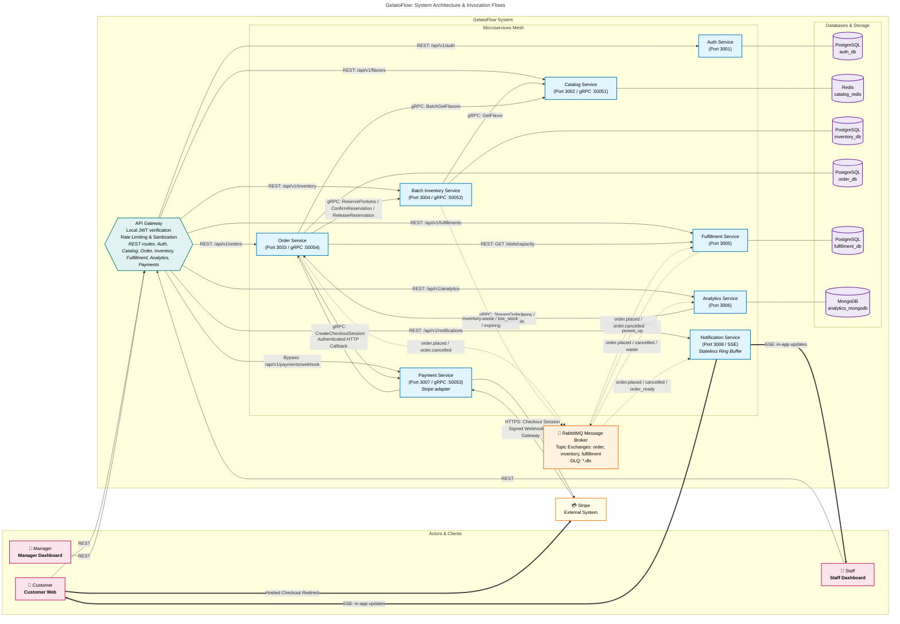
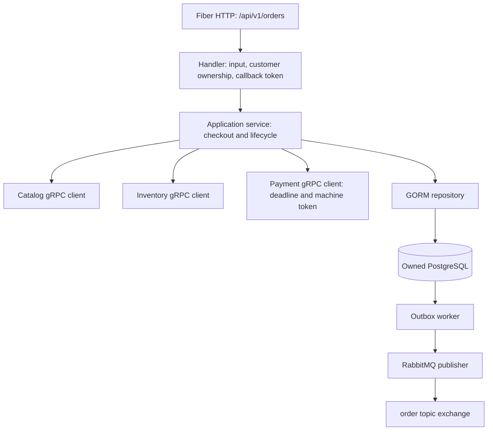

# GelatoFlow architecture and checkout boundaries

This view follows the current Order implementation and canonical contracts.
Solid edges describe implemented interfaces; dashed edges describe integration
targets or boundaries whose counterpart is pending. Neither a contract nor a
diagram proves a deployed, verified end-to-end connection.

## System view (GelatoFlow Architecture & Invocation Flows)

> [!NOTE]
> ไดอะแกรมนี้ถูกสร้างและแปลงผ่าน **Draw.io MCP (`open_drawio_mermaid`)** โดยอ้างอิงจากโครงสร้างสถาปัตยกรรม 9 ไมโครเซอร์วิสล่าสุดใน Codebase พร้อมแก้ไขเส้นทาง REST Routes จาก API Gateway ที่ขาดหายไปในรูปอ้างอิง Reference (`image1.png`)
>
> 🔗 **เปิดแก้ไขใน Draw.io Web Editor:** [คลิกที่นี่เพื่อเปิด Draw.io Editor](https://app.diagrams.net/?grid=0&pv=0&border=10&edit=_blank#create=%7B%22type%22%3A%22mermaid%22%2C%22compressed%22%3Atrue%2C%22data%22%3A%22rVhtb%2BI4EP41kbonUYVQmutHCNDbU3vXJZX2Y2WCAxYhjmJDy%2F36G9uJ7ZgmdMluIzaxx%2FOMx%2FPqwWDg%2BRNOeIa90cQLfC8IHnGGOF1k9F0NxSfG8R5eJmWyJRwn%2FFBiSXoPv9%2FzI00QJzSHD7GIAQvgmdA8JRvBwVd8%2FQyd6IErnjjbwfhAoqewKNmiksP401KTqyfJEGMznMpXgnNBlJIsk2xGaYLvcOIFEeMl3aktjJJg%2BOd4pQcH72TNtzAVFB8wmNCMlorQ9%2F12tA3i%2BB2dGnDYT4N06MD5fvhw3xuO4fJIEtyEG6bjFLtwQRiu1r3hOC3RxoFb4zC9d%2BDu0XD1gPrCrcTasnl0aQr6dNBwep%2F4fl80%2FMFxmaPMxYP9OXjpOEyHYV%2B8DG9wvm6ijcWfg%2FaAxd852tBFg38CrQnIDqtNiYotvEbSE5gYH0%2FB3SYJHCfTLqmnA288c7jYT3QAM9jDuUgm3sL3Hhbew9Cb3NmTo2gFJ7fwRnPxCv%2FpmcD%2FiWEgglkxXuHBDuRTuWs7fMxRmrrYD3d65gxYDQf%2BDLHtiqJyfT32M8rB%2FJ2dB940subO8OuJqyUQVtJ1ribyvumgq0S0YrIJyBeO97GKYOFUPGAlL9%2BtUbO7J4jfwlf%2B%2FvkKv0dckpRUEd0QLWGZiM9kTzjJN9rWYpTDwH8uObwSsWoeC54lxH3MVOSfHMDmA6HnCHGU0Y36%2BLdcC81GKqOA6mh5Up%2BLQyb8ai9jvxiYgGufOEmY%2BnxBp700d3kUpDqKcCae%2BjTqYH6m%2FDYHoyV%2Bi1VINm72TJKSMjP6jNn24inYj9y78lipBb%2BCsBR380JlIoSIM%2Fzm2FSdI74GVqtX4mldd0MGcukCfjfLF6FcQB37%2FrinKOZEpTBTxJNt86C7xbprESvoJ5ayOSlSZX7dYoxaxLjrJ0ZlwEqQ%2BuOCKGGLKKNv504Y85IUwnnRGhVcBjbLUa4W2%2FZLKXrDUbvFH%2FfT2D%2BUmxglsRsjF8D%2F1LqL4%2Fmn%2BoJokWEmXHypYt30kKa%2FTXEmfqlQYMJZt9z3v660TxOO%2FVgxL9YloZJrBiFjhRg2dYWm%2BMWQN5sCxxth3JTxTYnjH0%2FWDhFQvK2hgAZvtjdXgf1SsNNIS7wmzAJJ1PxbKcd7Qemo1b0tUpP13puMTd1gVJD0BrIcuBsuNYS9QbX5a8hnmm8ofFkmUtO87cXcNZAXPWGJVivCn380S0LfmzYmZdJnyk2mqqkxYr7SgkAz6s8%2FoJ3NN3XFQ01pQ5qljaVHi83s6Yda%2BMftOvtwfL7qpL5QV1Zh361wR2bKQM5Nx9QoLmtU3VF9osKxfKqmw7MvBJhDazUO0PhDFA0jWSCGQhePpkRrbEKV%2FF%2BlNyV654qWPTzqnn8JFasK%2FTcL8oFFc7cnjKmhjOQ7ERXTkooKfYkhN%2BA8wd8cvoZdQ5jqnmWBCgK%2Fx6F4FeWgFFIWhteySTN0FI1gaJfX1zKTZlvxUuXRtZyM1YfN%2Bv7qfRq%2FqQS0a49rueZWDVGxbZQVVx%2BuTvBhs325xHB6KhBjn7Es6p4nWLzj1ZbSneJdV4%2FtJl5ndSEI5yjZKj5N6qo7EddzOoM7rqz7CUVk8m%2BTzi7xFaWdPpu0dQ2u6Oqs16Rp1piKspm2nJ1YxVW1HSvftKspPuXJtqQ5PTApsw6Pdbkt68eqvY1QlrkqbG5cnadcK0%2FzEfOF9NUuVzX6cJfLBkrz6PT3diZLLOpHLOpLafD1piJxcVvu1XRdUFf7hbIYbMee6vTodvCoxGDu0RYnO4i0MeRUzcyy4Q5Wxtke569KQJZR6REJKlBC%2BOlSZGjahish5EiM9hL2OyREox%2FQu7JNzBHJ3ADZYk%2BmrRO2BCW31qsorH9WPqxMaYWSnWtOZn0t6V%2Bvry9xpcxKjUJqW5NVmm9Nwt5oJh%2FJDuo8meYsZqKILnHCO7jp3rIWKyabXPIxezoS5Fm3Ue1nfL5JEXtgRERgyVRs2tLS13Q%2FYQ1nnh%2Bru1Mll1Xa3UQZPaz1%2FPDWdzO6tsLbSkCZJG%2BLDCVSPmUhajBBUBJkGYxLKTVOR5youeqEefuOGMeasbgYhNNLdnoEfxSkFFVJF4YTNGsUK4veqgYCLH590ryhmN3h9duh6GRu6e8KrbR755f5Go4NpGozl9J4Dxh1Nuc5vcUMlxhlA0722FN9Pi4HsToRbXE38kKiud652bB9FqhVACD5ABUFvByKNRI3rSoh1J7%2BuxiqYtyf%2FA8%3D%22%2C%22version%22%3A%2212%22%7D)

The selected frontend checkout calls Order only. The public PaymentIntent API
on `chelsea/payment-service` is a separate implementation to migrate; it is not
a second frontend call in this Checkout Session flow. Payment implements the
inbound gRPC API and connects verified webhook results to Order HTTP callbacks.

## Order internals

Order snapshots names and integer minor-unit prices at checkout. It owns no live
Catalog records or Inventory stock balances and never reads their stores. Gateway
must verify JWTs and replace untrusted identity headers before setting X-User-ID.

Order exposes HTTP only; its Analytics gRPC read contract is not yet a running
server. Pickup-slot allocation, queue numbers, later fulfillment transitions,
low-stock/expiring events remain integration/design work. Fulfillment's kitchen
tickets and per-slot queues and Notification's stateless SSE/consumer are
implemented; Gateway and broker runtime integration still need verification.
Notification keeps only bounded in-memory order-owner routing and event IDs,
with no database or replay after restart. See the service READMEs and the
temporary routing exception in service-data-ownership.md.
Order publisher acknowledgement matching and reconnect findings remain open.

See [sequence diagrams](sequence-diagram.md), [overview](overview-architecture.md),
[checkout boundary](architecture/order-checkout.md) and
[data ownership](architecture/service-data-ownership.md).
