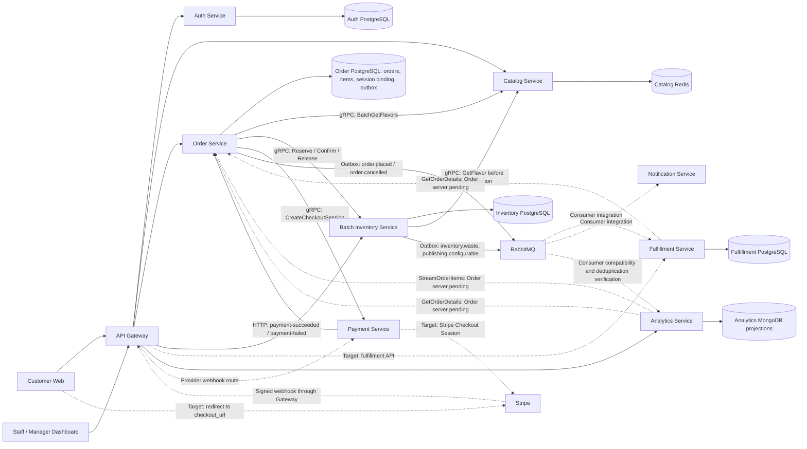
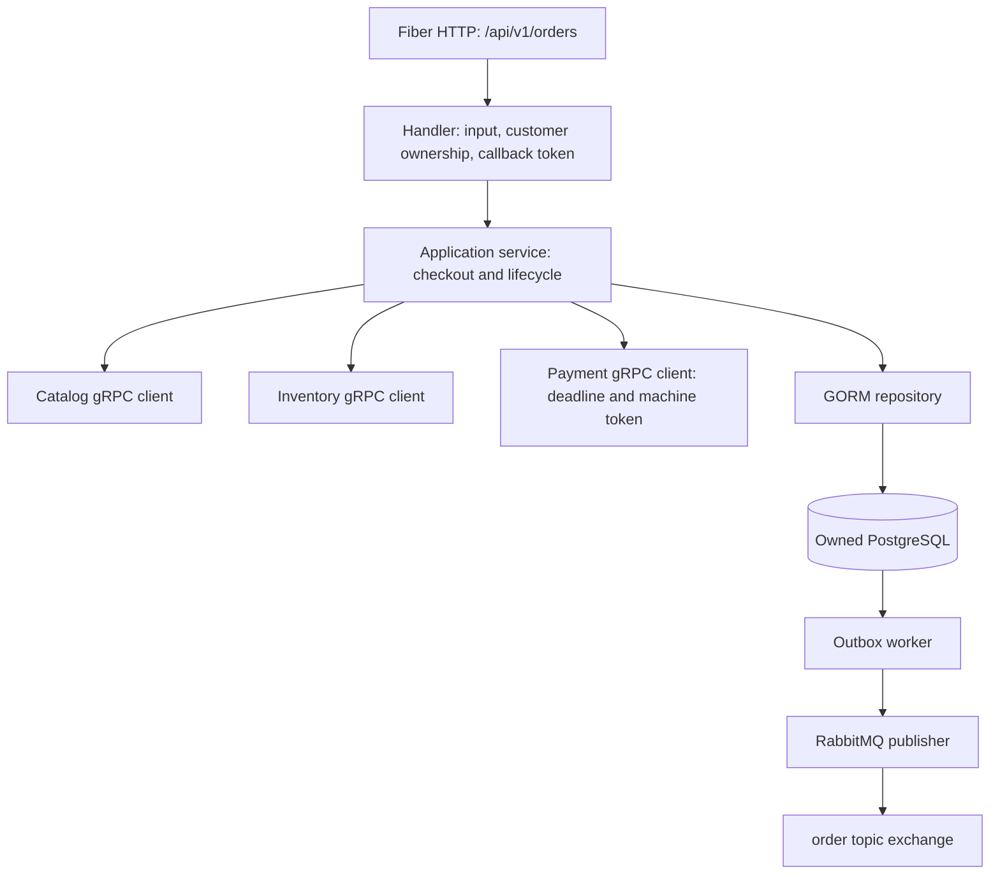

# GelatoFlow architecture and checkout boundaries

This view follows the current Order implementation and canonical contracts.
Solid edges describe implemented interfaces; dashed edges describe integration
targets or boundaries whose counterpart is pending. Neither a contract nor a
diagram proves a deployed, verified end-to-end connection.

## System view

The selected frontend checkout calls Order only. The public PaymentIntent API
on `chelsea/payment-service` is a separate implementation to migrate; it is not
a second frontend call in this Checkout Session flow. Payment implements the
inbound gRPC API and connects verified webhook results to Order HTTP callbacks.

## Order internals

Order snapshots names and integer minor-unit prices at checkout. It owns no live
Catalog records or Inventory stock balances and never reads their stores. Gateway
must verify JWTs and replace untrusted identity headers before setting X-User-ID.

Order exposes HTTP only; its Analytics gRPC read contract is not yet a running
server. Pickup-slot allocation, queue numbers, later fulfillment transitions,
low-stock/expiring events remain integration/design work. Fulfillment's kitchen
tickets and per-slot queues and Notification's stateless SSE/consumer are
implemented; Gateway and broker runtime integration still need verification.
Notification keeps only bounded in-memory order-owner routing and event IDs,
with no database or replay after restart. See the service READMEs and the
temporary routing exception in service-data-ownership.md.
Order publisher acknowledgement matching and reconnect findings remain open.

See [sequence diagrams](sequence-diagram.md), [overview](overview-architecture.md),
[checkout boundary](architecture/order-checkout.md) and
[data ownership](architecture/service-data-ownership.md).
