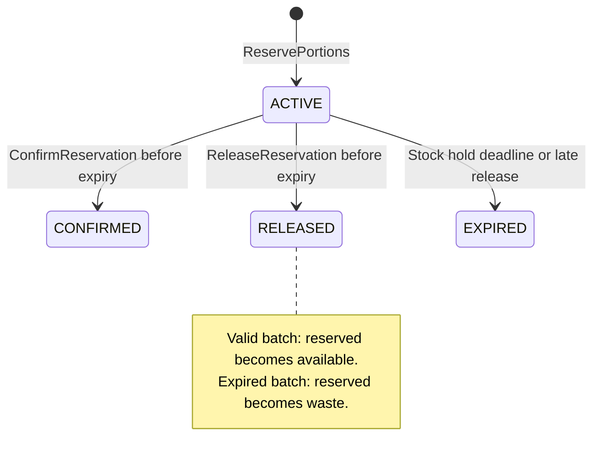

# Inventory Reservation Decision

Batch Inventory Service is the source of truth for portion availability. Its most
important quality requirement is preventing overselling when concurrent orders
request the same remaining portions.

## Portion balances

Each batch maintains non-negative balances:

- `available_portions`
- `reserved_portions`
- `sold_portions`
- `wasted_portions`

The balances must satisfy this invariant:

```text
initial_portions = available + reserved + sold + wasted
```

Expired batches are excluded from availability even if their stored available
balance is greater than zero.

## Reservation lifecycle



- Reserving moves portions from `available` to `reserved`.
- Confirming moves portions from `reserved` to `sold`.
- Releasing or expiring moves portions from `reserved` back to `available`, unless
  the batch has expired and the portions must be recorded as waste.
- Reservation expiry and batch expiry are distinct. An expired reservation can
  return its portions to available when the underlying batch is still valid.

## Allocation policy

Inventory allocates portions using FEFO (first-expired, first-out):

1. Exclude inactive and expired batches.
2. Sort by `expires_at`, then by creation time and UUID for deterministic ties.
3. Lock candidate rows inside one database transaction.
4. Allocate the requested quantity across the minimum required batches.
5. Update balances and create the reservation before committing.

Order Service requests quantities by `flavor_id`; it does not choose batch IDs.

## Concurrency and idempotency

`ReservePortions`, `ConfirmReservation`, and `ReleaseReservation` accept an
`idempotency_key`. Repeating the same operation with the same key returns the
original result rather than changing stock twice.

Replay is the original successful response, not a fresh state query: Reserve can
replay ACTIVE after a later release/confirmation. Order therefore retains a
bounded reservation on an ambiguous order-save failure instead of releasing a
hold that a same-key retry may still use. Payment-call timeout also retains the
hold. Inventory expires abandoned reservations independently.

Reservation updates use a PostgreSQL transaction and row-level locking. The
implementation must reject the entire reservation when the full requested
quantity cannot be allocated; partial success is not allowed in version 1.

Expected contention test:

```text
Given one available portion
When 20 reservation requests run concurrently
Then exactly one request succeeds
And the final available balance is zero, never negative
```

## Integration contract

The client supports these internal gRPC operations:

- `CheckAvailability`
- `ReservePortions`
- `ConfirmReservation`
- `ReleaseReservation`

Checkout directly calls ReservePortions rather than requiring a prior
CheckAvailability read. Availability is only a snapshot, not a reservation promise.
The default reservation TTL is ten minutes, capped by allocated batch expiry.

Successful verified payment leads to confirmation. Customer cancellation and a
verified terminal payment failure call ReleaseReservation. A Payment transport
timeout does not prove payment failure and does not immediately release stock;
Order retains its pending record for idempotent retry until the hold expires.

## Cancellation and local Order state

Order checks customer ownership and atomically claims CANCEL_PENDING from
PENDING_PAYMENT before releasing any stock. It uses the existing status column
and stable release key with the constant reason ORDER_CANCELLED; no new columns
are needed. CANCEL_PENDING blocks checkout and payment confirmation. On release
success, Order commits CANCELLED and order.cancelled together in its own database.
If release or local finalization fails, the durable intent remains. A lifecycle
worker resumes it after restart, replaying the same operation/reason/key;
Inventory must not return portions twice.

Payment success first claims PAYMENT_CONFIRMING from PENDING_PAYMENT under the
same Order row lock, so cancellation and confirmation cannot both claim a pending
order. Confirmation retries retain that intent on ambiguous failures. A definitive
FAILED_PRECONDITION moves it to CANCEL_PENDING for release, without marking PAID
or emitting order.placed. Payment remains responsible for refunds/reconciliation.

| Condition on release | Reservation result | Portion movement |
| --- | --- | --- |
| Hold and batch still valid | RELEASED | reserved -> available |
| Hold expired, batch still valid | EXPIRED | reserved -> available |
| Allocated batch expired | RELEASED/EXPIRED according to hold state | reserved -> wasted |

For a valid batch with ten initial portions, cancelling a two-portion hold changes
available=8/reserved=2 to available=10/reserved=0; the invariant remains intact.
Paid orders do not use this pending-order release path; refund/return workflows
need a separate design.

Inventory's expiry worker settles stock, but Order has no automatic expiry worker
and can remain PENDING_PAYMENT. A late ConfirmReservation returns a conflict;
Order must not mark PAID or emit order.placed. Payment reconciliation/refund remains
required. Order cancellation currently does not close a Stripe Checkout Session.

Inventory waste and its transactional outbox commit together, then publication
occurs asynchronously. See [checkout boundary](order-checkout.md) and
[cancellation/expiry sequences](../sequence-diagram.md).
