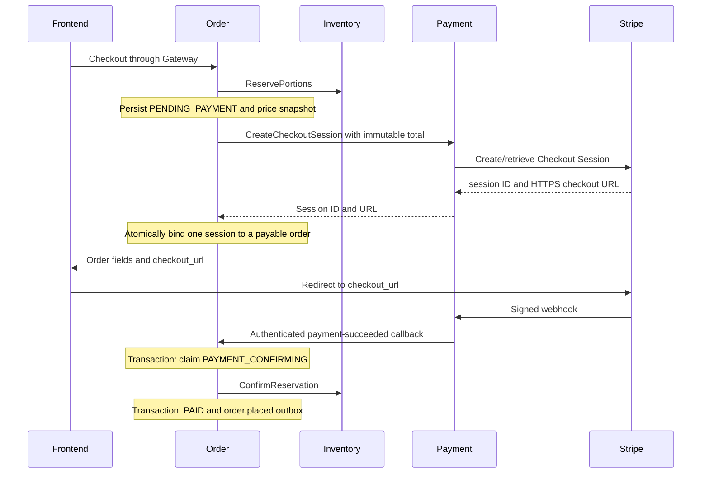
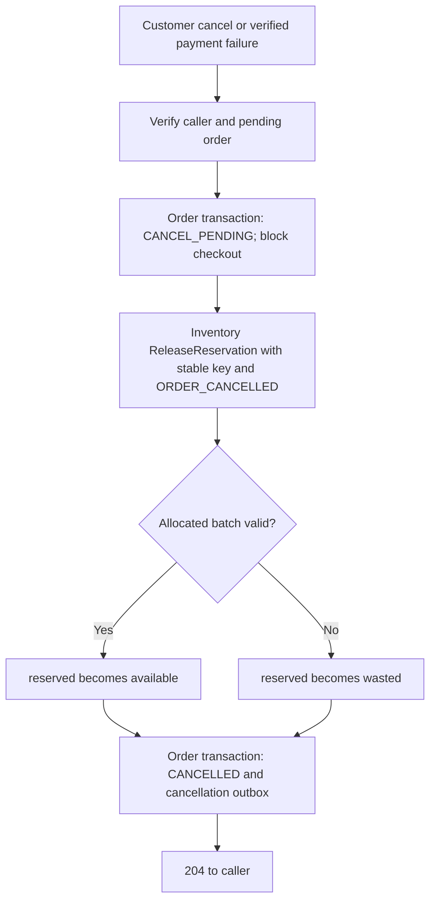

# Order-orchestrated Stripe checkout

Status: Order checkout and Payment's inbound Checkout Session gRPC/Stripe adapter
implemented; Checkout webhook reporting, reconciliation/refunds and deployed
end-to-end verification pending. The boundary requires Order, Payment, Gateway
and frontend owner review before shared deployment.

## Ownership and transport

Frontend calls `POST /api/v1/orders` through the JWT-verifying Gateway. Order
retrieves Catalog prices, reserves Inventory portions, persists the pending order,
then calls `payment.v1.PaymentService/CreateCheckoutSession`. Payment owns Stripe
credentials, provider APIs, webhook verification and refund/reconciliation.
Order owns checkout totals, the durable Checkout Session binding and order state.
Neither service accesses another service's database.

The new canonical internal API is `contracts/proto/payment/v1/payment.proto`.
Order sends immutable order/customer UUIDs, integer amount, currency, stock hold
deadline and a deterministic UUID checkout key derived from the order ID.
Payment must authenticate `authorization: Bearer <PAYMENT_REQUEST_TOKEN>` as the
Order machine identity. Customer JWTs must not authorize this internal method.
The reverse HTTP callbacks use the separate `PAYMENT_SERVICE_TOKEN`; Inventory
uses its own `ORDER_SERVICE_TOKEN`. Plaintext gRPC is for isolated local development
only; deployment requires the agreed TLS/machine identity policy.

## Happy path

Create responses retain the existing order fields and add `checkout_url` only
for payable pending orders. GET Order omits the URL. Create responses use
`Cache-Control: no-store`; URLs must not be logged. Payment configures trusted
success/cancel URLs itself; callers cannot supply redirect targets. After Stripe
redirects back, frontend reads GET Order and polls while payment processing is
pending. A browser success redirect never marks an order paid.

## Retry and failure rules

- Payment must create/retrieve exactly the same session for a checkout key and
  reject changed immutable facts with ALREADY_EXISTS. Use provider idempotency
  and durable reconciliation as needed. Order's persisted session survives restarts.
  The current stateless Payment adapter relies on provider key retention and
  rejects expired stock holds; permanent deduplication after key pruning requires
  later durable reconciliation. See the [Payment gRPC guide](../../payment-service/GRPC.md).
- Order stores the order before calling Payment and binds the session before
  exposing a URL. No PostgreSQL transaction or row lock spans a network call.
- A Payment timeout/unavailable response keeps the existing pending order and
  stock hold. The error includes `details.order_id`. Retry the exact original
  request and Idempotency-Key. Order does not automatically retry an ambiguous
  mutation; replay uses the same deterministic checkout key.
- A failed/ambiguous session binding exposes no URL. A retry asks Payment for
  the same session, then retries the atomic binding. A different session, a
  cancellation/confirmation intent, cancelled/paid order or an expired hold is
  rejected under the row lock.
- A failed order insert no longer compensates by immediately releasing a shared
  reservation. Another same-key request might still commit, and Inventory replay
  returns its original ACTIVE result even after release. Keep the bounded hold
  for retry; Inventory's expiry worker cleans up abandoned reservations.
- New checkout totals must be positive and at most 99,999,999 minor units.
  Idempotent replays of workflow intents and terminal orders return current state
  without checkout_url.
- Stripe's session expiry may differ from Inventory's stock deadline. Payment
  must handle expired-session UX and reconcile/refund a charge whose stock can
  no longer be confirmed. Order's ConfirmReservation still rejects expired stock.

## Cancellation, stock release and provider session

Customer calls POST /api/v1/orders/{id}/cancel with reason CUSTOMER_REQUEST through
Gateway. Order verifies ownership and permits only pending-payment cancellation.
Payment's verified payment-failed callback uses its machine token and the reason
PAYMENT_FAILED. Both paths first commit CANCEL_PENDING in the existing status
column, clearing the stored checkout URL. A short row lock serializes this claim
with checkout binding and the payment-success claim of PAYMENT_CONFIRMING. The
first workflow to claim PENDING_PAYMENT wins; the other receives a conflict.
Neither a transaction nor row lock spans an Inventory network call.

After the claim, both cancellation paths call Inventory ReleaseReservation with
the persisted reservation/order IDs, existing deterministic release key, and
constant reason ORDER_CANCELLED. The original caller's reason is not persisted;
no columns or tables are added. On success, Order commits CANCELLED and
order.cancelled together, using the same generic reason in the event.

Inventory returns RELEASED or EXPIRED. Each allocation returns to available if
its batch is still valid; expired-batch portions become waste. If release succeeds
and the Order commit fails, CANCEL_PENDING still blocks checkout. Retry either
endpoint, or let the lifecycle worker resume after restart with identical request
facts. An already cancelled order is a no-op; PAYMENT_CONFIRMING and paid orders
cannot use this cancellation endpoint. A dependency error can leave a durable
intent even though the request did not return 204.

The lifecycle worker also resumes PAYMENT_CONFIRMING after ambiguous confirmation
or local PAID/outbox failures. It uses the persisted confirmation key and never
reopens checkout. An authoritative Inventory FAILED_PRECONDITION moves that
intent to CANCEL_PENDING; the callback returns 409 and Payment must durably
reconcile/refund the charge. Other dependency errors retain the intent for retry
and operator attention. Recovery pages by order ID and continues past failed
orders, so a failed page does not starve later work.

There is no Order-to-Payment cancel-session RPC in the current contract or code.
The existing URL can remain payable after stock release, and a browser cancel
redirect is not automatically an Order cancellation. A late success for
CANCEL_PENDING or CANCELLED is rejected; a late success after Inventory expiry
cannot confirm stock. Payment
must durably reconcile/refund such charges. Inventory expires holds independently,
but Order has no worker that automatically changes its pending status.

See [detailed sequence and state diagrams](../sequence-diagram.md) and
[Inventory lifecycle](inventory-reservation.md).

## Integration status and migration

Order's outbound client, binding, REST response and retry handling are implemented.
Payment implements the new authenticated gRPC server and Stripe Checkout adapter.
Its retained PaymentIntent REST/webhook code still uses `client_secret` and
Payment-to-Order gRPC binding/reporting; Order does not implement those RPCs.
Payment must connect verified Checkout provider results to Order's existing
authenticated HTTP callbacks (or jointly migrate callbacks to the proposed
result-reporting gRPC contract). Frontend uses the new checkout_url instead of
calling the old public PaymentIntent endpoint. See
[Payment integration](payment-integration.md) for the incremental migration.

This change does not claim a working Stripe end-to-end integration, refund
automation or Order gRPC reads for Analytics.
REST clients must handle CANCEL_PENDING and PAYMENT_CONFIRMING without checkout
navigation and poll until finalization. Review these enum additions and the
generic cancellation event reason with affected service and frontend owners.
Before updating an older deployment, reconcile pending rows whose Inventory
transition already succeeded; an old release key used with CUSTOMER_REQUEST or
PAYMENT_FAILED cannot be replayed with ORDER_CANCELLED without conflict.
Order's RabbitMQ publisher serializes sends, matches confirmation delivery tags,
and rejects mandatory returns even when an ACK follows. Every failed publish
retires its connection and listeners; the next worker attempt reconnects and
retries the pending outbox row with its original event ID. The worker marks a row
published only after its own ACK with no return. Its one-second tick bounds retry
frequency; network connection/setup and writes are deadline-bounded. Ambiguous
failures can cause duplicate delivery, so consumers must deduplicate event IDs.
Queue bindings must exist for delivery; a missing binding keeps the row pending.
Review the shared boundary with affected owners before deployment.
