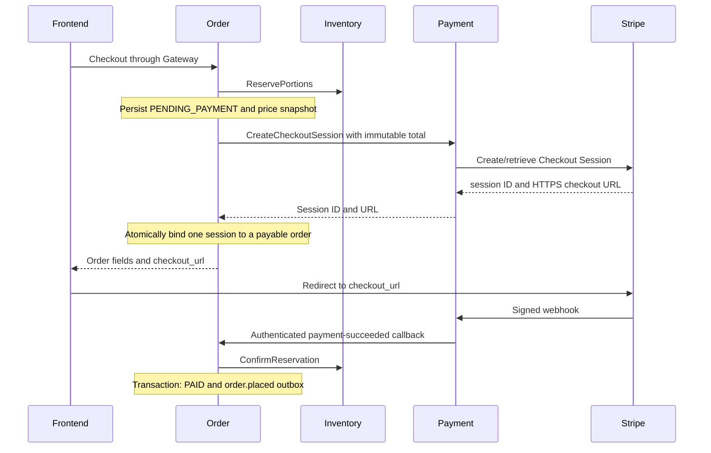

# Order-orchestrated Stripe checkout

Status: Order implementation; new Payment boundary proposed for Order, Payment,
Gateway and frontend owner review before shared deployment.

## Ownership and transport

Frontend calls `POST /api/v1/orders` through the JWT-verifying Gateway. Order
retrieves Catalog prices, reserves Inventory portions, persists the pending order,
then calls `payment.v1.PaymentService/CreateCheckoutSession`. Payment owns Stripe
credentials, provider APIs, webhook verification and refund/reconciliation.
Order owns checkout totals, the durable Checkout Session binding and order state.
Neither service accesses another service's database.

The new canonical internal API is `contracts/proto/payment/v1/payment.proto`.
Order sends immutable order/customer UUIDs, integer amount, currency, stock hold
deadline and a deterministic UUID checkout key derived from the order ID.
Payment must authenticate `authorization: Bearer <PAYMENT_REQUEST_TOKEN>` as the
Order machine identity. Customer JWTs must not authorize this internal method.
The reverse HTTP callbacks use the separate `PAYMENT_SERVICE_TOKEN`; Inventory
uses its own `ORDER_SERVICE_TOKEN`. Plaintext gRPC is for isolated local development
only; deployment requires the agreed TLS/machine identity policy.

## Happy path

Create responses retain the existing order fields and add `checkout_url` only
for payable pending orders. GET Order omits the URL. Create responses use
`Cache-Control: no-store`; URLs must not be logged. Payment configures trusted
success/cancel URLs itself; callers cannot supply redirect targets. After Stripe
redirects back, frontend reads GET Order and polls while payment processing is
pending. A browser success redirect never marks an order paid.

## Retry and failure rules

- Payment must create/retrieve exactly the same session for a checkout key and
  reject changed immutable facts with ALREADY_EXISTS. Use provider idempotency
  and durable reconciliation as needed. Order's persisted session survives restarts.
- Order stores the order before calling Payment and binds the session before
  exposing a URL. No PostgreSQL transaction or row lock spans a network call.
- A Payment timeout/unavailable response keeps the existing pending order and
  stock hold. The error includes `details.order_id`. Retry the exact original
  request and Idempotency-Key. Order does not automatically retry an ambiguous
  mutation; replay uses the same deterministic checkout key.
- A failed/ambiguous session binding exposes no URL. A retry asks Payment for
  the same session, then retries the atomic binding. A different session, a
  cancelled/paid order or an expired hold is rejected under the row lock.
- A failed order insert no longer compensates by immediately releasing a shared
  reservation. Another same-key request might still commit, and Inventory replay
  returns its original ACTIVE result even after release. Keep the bounded hold
  for retry; Inventory's expiry worker cleans up abandoned reservations.
- New checkout totals must be positive and at most 99,999,999 minor units.
  Idempotent replays of terminal orders return current state without checkout_url.
- Stripe's session expiry may differ from Inventory's stock deadline. Payment
  must handle expired-session UX and reconcile/refund a charge whose stock can
  no longer be confirmed. Order's ConfirmReservation still rejects expired stock.

## Integration status and migration

Order's outbound client, binding, REST response and retry handling are implemented.
The existing `chelsea/payment-service` branch implements PaymentIntent creation,
returning `client_secret`, and Payment-to-Order gRPC binding/reporting. It does not
implement this Checkout Session API and cannot be connected unchanged. Payment
must add the new gRPC server and Checkout adapter, and connect verified provider
results to Order's existing authenticated HTTP callbacks (or jointly migrate
callbacks to the proposed result-reporting gRPC contract). Frontend uses the new
checkout_url instead of calling the old public PaymentIntent endpoint.

This change does not claim a working Stripe end-to-end integration, refund
automation, Order gRPC reads for Analytics, or Payment's implementation.
Order's pre-existing RabbitMQ confirmation/reconnect review findings remain
separate work. Review the shared boundary with affected owners before deployment.
