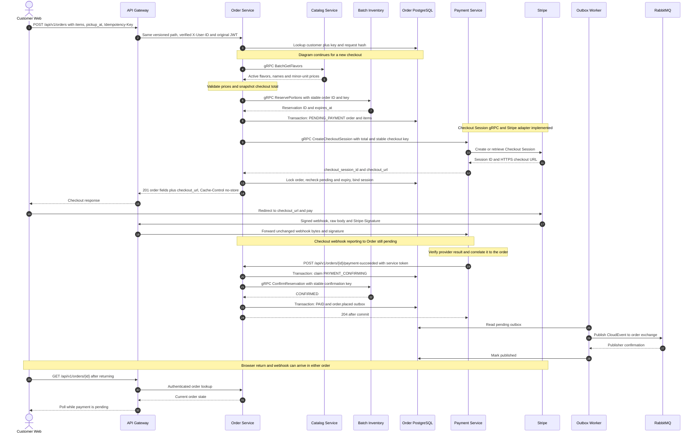
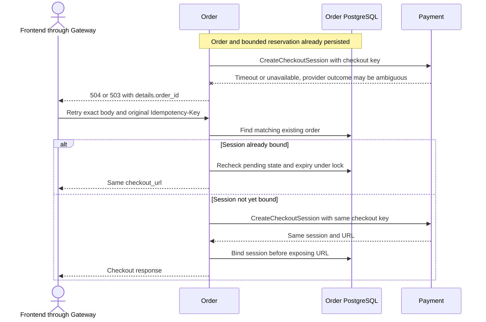
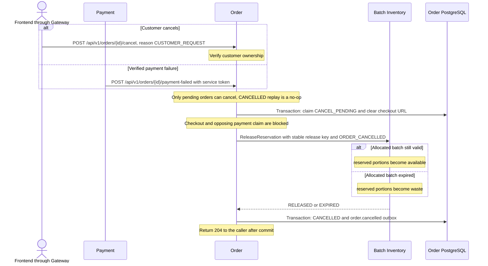
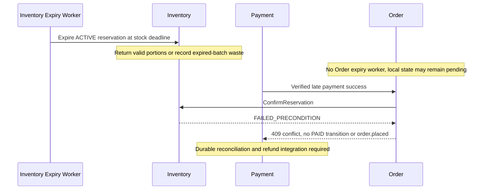
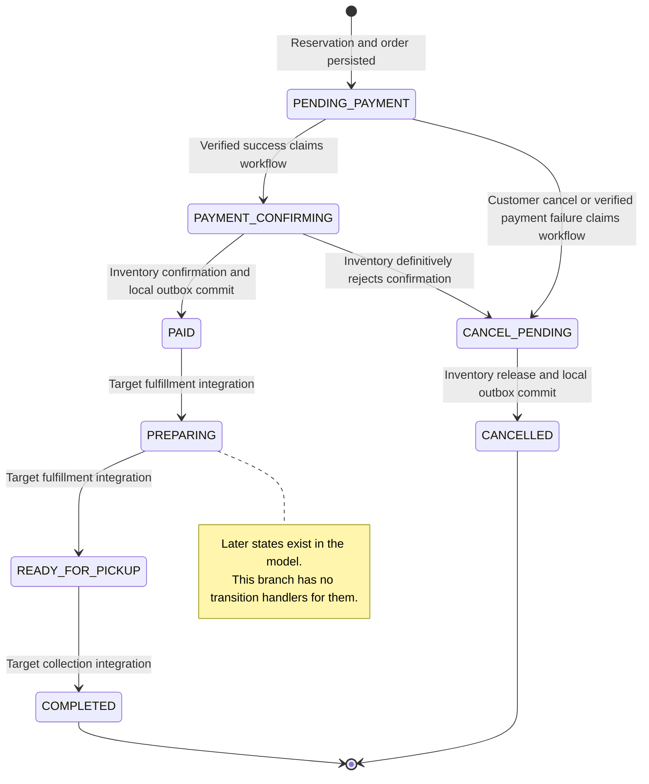

# Order checkout and reservation sequence diagrams

Order handlers and outbound clients and Payment's authenticated
CreateCheckoutSession server/Stripe adapter are implemented. Payment's Checkout
webhook adapter is pending; webhook/callback steps below describe the selected
integration target. Deployed end-to-end integration remains unverified.
Contracts under ../contracts/ remain authoritative.

## Checkout and successful payment

Session creation and a success redirect never mark an order paid. Order's
publisher matches confirmations to the current delivery tag, rejects mandatory
returns and reconnects after failures. Broker runtime integration remains
unverified; ambiguous failures can deliver duplicate events.

The legacy PaymentIntent flow uses a separate frontend Payment REST call,
`client_secret`, and Payment-to-Order `GetOrderDetails`, `BindPaymentIntent` and
`ReportPaymentResult` RPCs. Order does not implement that gRPC server, so it is
not part of the selected Checkout Session sequence. See
[Payment integration](architecture/payment-integration.md) for migration details.

## Retry after Payment timeout or unavailable response

Payment must honor idempotency. Order does not release the hold on a Payment
timeout or automatically retry that mutation. A changed request with the same key
returns 409. An expired hold returns 409; a new checkout requires a new key.

## Customer cancellation and payment failure

An Inventory error prevents final cancellation commit, while CANCEL_PENDING
remains durable. If release succeeds but Order's database commit fails, retries
or the lifecycle worker use the same Inventory key and constant reason. Order currently does
not expire/cancel Stripe sessions; payment through an old URL requires
reconciliation/refund and must not revive a cancelled order.

## Expiry and late payment

## Order state and downstream targets

Fulfillment's queue allocation and Notification's SSE/event consumer are
implemented; their Gateway and broker runtime integration remains to be verified.
Notification sends queue numbers on order.ready and keeps only a bounded,
in-memory order-owner map from order.placed. A never-paid cancellation may have
no owner in that map and must not be interpreted as reversal of a paid sale.
Analytics' GetOrderDetails and StreamOrderItems contracts exist, but
Order does not implement its server. Order accepts pickup_at, not a pickup-slot
ID, and its response does not allocate a queue number.
